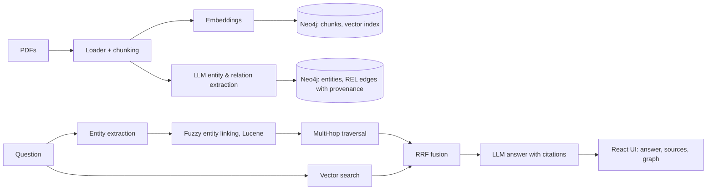

# Hybrid GraphRAG Platform – Enterprise Knowledge Intelligence

An intelligent enterprise knowledge retrieval platform that combines **Graph Retrieval-Augmented Generation (GraphRAG)**, knowledge graphs, and hybrid information retrieval to answer complex, multi-hop questions across interconnected documents.

The platform transforms unstructured enterprise documents into structured knowledge graphs in **Neo4j**, enabling relationship-aware retrieval and contextual question answering with full source traceability.

---

## Architecture



### Graph Model
```text
(:Document)-[:HAS_CHUNK]->(:Chunk)-[:MENTIONS]->(:Entity)-[:REL {type, sources}]->(:Entity)
```
Each relationship retains the chunk IDs from which it was extracted, ensuring every fact is traceable back to its exact document and page.

---

## Key Features

- **Document Ingestion:** PDF loading, text extraction, recursive chunking, and local embedding generation.
- **LLM-Powered Knowledge Extraction:** Automated identification of entities (`Person`, `Project`, `Department`, `Role`, `Client`, `Technology`) and typed relationships.
- **Neo4j Knowledge Graph:** Scalable graph storage with full-text indexes and vector index for chunk embeddings.
- **Multi-Hop Traversal:** Flexible graph expansion (1–3 hops) traversing connected entities while avoiding high-degree hubs.
- **Hybrid Fusion:** Combines vector similarity retrieval and graph traversal using Reciprocal Rank Fusion (RRF).
- **Interactive UI:** React + Vite application featuring live knowledge graph visualization (`ForceGraph2D`), source passage inspection, and instant Q&A.

---

## Retrieval Modes

| Mode | What it does |
|---|---|
| `vector` | Baseline RAG: embedding similarity search across document chunks. |
| `graph` | Entity linking, 1–3 hop graph traversal, and chunks supporting traversed facts. |
| `hybrid` | Both vector and graph retrieval merged with Reciprocal Rank Fusion (RRF). |

---

## Technology Stack

| Category | Technologies |
|---|---|
| **Programming Language** | Python 3.12, JavaScript / React 18 |
| **Frameworks** | FastAPI, LangChain, Vite |
| **LLM Providers** | Groq (`openai/gpt-oss-120b`, `openai/gpt-oss-20b`), Azure OpenAI, OpenAI |
| **Embeddings** | FastEmbed (`BAAI/bge-small-en-v1.5`) / OpenAI |
| **Graph Database** | Neo4j 5 (Bolt + Cypher) |
| **Visualization** | React Force Graph 2D |
| **Containerization** | Docker, Docker Compose |

---

## Project Structure

```text
hybrid-graphrag-platform/
├── backend/
│   ├── app/
│   │   ├── evaluation/       # Benchmark suite & evaluation questions
│   │   ├── ingestion/        # PDF loading, chunking, LLM extraction & Neo4j loading
│   │   ├── rag/              # Q&A answering pipeline & prompt templates
│   │   ├── retrieval/        # Vector search, entity linking, multi-hop traversal & RRF
│   │   ├── config.py         # App settings & environment validation
│   │   ├── db.py             # Neo4j connection & schema initialization
│   │   ├── llm.py            # LLM & embeddings factory (Groq / Azure / OpenAI)
│   │   └── main.py           # FastAPI application & API endpoints
│   ├── Dockerfile
│   └── requirements.txt
├── frontend/
│   ├── src/
│   │   ├── components/       # Chat, GraphView, Sidebar & ErrorBoundary
│   │   ├── api.js            # Backend API client
│   │   ├── App.jsx           # Main React application
│   │   └── styles.css        # Responsive styling
│   ├── Dockerfile
│   ├── nginx.conf
│   └── package.json
├── data/                     # Source enterprise PDF documents
├── docker-compose.yml        # Multi-container orchestration (Neo4j, Backend, Frontend)
├── .env.example              # Environment variables template
└── README.md
```

---

## Getting Started

### Prerequisites
- [Docker Desktop](https://www.docker.com/products/docker-desktop/)
- An API Key from **Groq**, **Azure OpenAI**, or **OpenAI**

### 1. Configuration
Copy the template and configure your environment:
```bash
cp .env.example .env
```

For **Groq**:
```env
LLM_PROVIDER=groq
GROQ_API_KEY=gsk_your_groq_api_key
GROQ_CHAT_MODEL=openai/gpt-oss-120b
EMBEDDING_MODEL=BAAI/bge-small-en-v1.5
EMBEDDING_DIM=384
NEO4J_URI=bolt://localhost:7687
NEO4J_USER=neo4j
NEO4J_PASSWORD=nexagraph_dev
```

### 2. Run with Docker Compose
```bash
docker compose up --build -d
```

- **Frontend Application:** [http://localhost:3100](http://localhost:3100)
- **FastAPI Documentation:** [http://localhost:8000/docs](http://localhost:8000/docs)
- **Neo4j Browser:** [http://localhost:7474](http://localhost:7474)

### 3. Build the Knowledge Graph
1. Open [http://localhost:3100](http://localhost:3100).
2. Click **Build knowledge graph** (or click **Rebuild from scratch**).
3. Once complete, explore the interactive graph and ask multi-hop questions.

---

## Benchmark: Vector vs Graph vs Hybrid

Run the automated evaluation benchmark:
```bash
cd backend
python -m app.evaluation.run_eval --modes vector graph hybrid
```
Results are saved to `eval_results/results.md` measuring accuracy and latency across single-hop and multi-hop questions.
