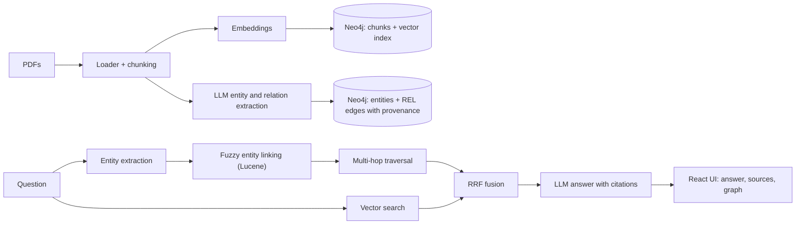

# Hybrid GraphRAG Platform

**Ask questions that span several documents, and see how the answer was built.**

This platform turns unstructured enterprise PDFs into a **Neo4j knowledge graph** and answers **multi-hop questions** with cited sources and a visible reasoning graph. Example: *"Which Vice President does Maya Patel ultimately report to?"* needs three facts from different documents: Maya → Ravi Iyer → Fatima Al-Farsi. A classic vector RAG often misses the chain; graph traversal follows it.

A built-in benchmark compares three retrieval strategies (vector, graph, hybrid) on the same questions.


---

## Features

- **Ingestion pipeline:** PDF loading, recursive chunking, local embeddings, LLM extraction of entities and typed relationships, loading into Neo4j.
- **Knowledge graph with provenance:** every relationship keeps the chunk ids it came from, so each fact traces back to a document and page.
- **Multi-hop retrieval:** fuzzy entity linking (Lucene full-text), then 1 to 3 hop traversal that does not walk through very connected hub nodes.
- **Hybrid fusion:** vector similarity and graph retrieval merged with Reciprocal Rank Fusion (RRF).
- **Explainable answers:** inline citations `[S1]`, expandable source passages, and the subgraph used for each answer.
- **Switchable LLM provider:** Groq, Azure OpenAI or OpenAI; local embeddings with FastEmbed.
- **Benchmark suite:** vector vs graph vs hybrid, scored by an LLM judge.

## Architecture



**Graph model**

```text
(:Document)-[:HAS_CHUNK]->(:Chunk)-[:MENTIONS]->(:Entity)-[:REL {type, sources}]->(:Entity)
```

Entity types: `Person`, `Project`, `Client`, `Department`, `Technology`, `Product`, `Location`, `Role`, `Certification`, and others.

## Retrieval modes

| Mode | What it does |
|---|---|
| `vector` | Baseline RAG: embedding similarity over document chunks. |
| `graph` | Entity linking, 1 to 3 hop traversal, and the chunks that support the traversed facts. |
| `hybrid` | Vector and graph results merged with RRF. |

## Tech stack

| Category | Technologies |
|---|---|
| Languages | Python 3.12, JavaScript (React 18) |
| Backend | FastAPI, LangChain |
| Frontend | React, Vite, React Force Graph 2D |
| LLM providers | Groq (`openai/gpt-oss-120b`, `openai/gpt-oss-20b`), Azure OpenAI, OpenAI |
| Embeddings | FastEmbed (`BAAI/bge-small-en-v1.5`) or OpenAI |
| Database | Neo4j 5 (Cypher, full-text and vector indexes) |
| DevOps | Docker, Docker Compose, Nginx |

## Project structure

```text
hybrid-graphrag-platform/
├── backend/
│   ├── app/
│   │   ├── evaluation/    # benchmark runner + questions.json
│   │   ├── ingestion/     # PDF loading, chunking, LLM extraction, Neo4j loading
│   │   ├── rag/           # answer pipeline and prompts
│   │   ├── retrieval/     # vector search, entity linking, traversal, RRF
│   │   ├── config.py      # settings and environment validation
│   │   ├── db.py          # Neo4j connection and schema (indexes, constraints)
│   │   ├── llm.py         # LLM and embeddings factory
│   │   └── main.py        # FastAPI app and endpoints
│   ├── Dockerfile
│   └── requirements.txt
├── frontend/
│   ├── src/               # components (Chat, GraphView, Sidebar), api.js, App.jsx
│   ├── Dockerfile
│   └── nginx.conf
├── data/                  # put your PDFs here (git-ignored)
├── docker-compose.yml     # Neo4j + backend + frontend
└── .env.example
```

## Getting started

### Prerequisites
- [Docker Desktop](https://www.docker.com/products/docker-desktop/)
- An API key from **Groq**, **Azure OpenAI** or **OpenAI**

### 1. Configure
```bash
cp .env.example .env
```
Minimal Groq setup:
```env
LLM_PROVIDER=groq
GROQ_API_KEY=gsk_your_key
GROQ_CHAT_MODEL=openai/gpt-oss-120b
EMBEDDING_MODEL=BAAI/bge-small-en-v1.5
EMBEDDING_DIM=384
NEO4J_USER=neo4j
NEO4J_PASSWORD=choose_a_password_of_8_chars_or_more
```
For Azure OpenAI or OpenAI, see the variables listed in `.env.example`. Inside Docker Compose the backend reaches Neo4j through the service name, so `NEO4J_URI` only matters for local development.

### 2. Add documents
Copy your PDFs into `data/` (or upload them from the UI). The demo uses a synthetic company, *NexaTech Solutions*: organization structure, employee directory, project portfolio and client profiles.

### 3. Run
```bash
docker compose up --build -d
```

| Service | URL |
|---|---|
| Web application | http://localhost:3100 |
| API documentation | http://localhost:8000/docs |
| Neo4j Browser | http://localhost:7474 |

### 4. Build the graph and ask
1. Open http://localhost:3100.
2. Click **Build knowledge graph** (or **Rebuild from scratch**) and wait for the progress bar.
3. Ask a question, click a `[S1]` citation to read the source, and use **Show reasoning graph** to see the path used.

### Local development (hot reload)
```bash
docker compose up neo4j -d

cd backend
python -m venv .venv && source .venv/bin/activate    # Windows: .venv\Scripts\activate
pip install -r requirements.txt
uvicorn app.main:app --reload --port 8000

# in another terminal
cd frontend && npm install && npm run dev            # http://localhost:5173
```

## Example questions

| Type | Question |
|---|---|
| Single-hop | Who is the project manager of Project Titan? |
| Multi-hop | Which Vice President does Maya Patel ultimately report to? |
| Multi-hop | Who is the account manager of the client of Project Titan, and which office are they in? |
| Aggregation | Which employees hold the Neo4j Certified Professional certification? |

## Benchmark: vector vs graph vs hybrid

```bash
# local environment
cd backend && python -m app.evaluation.run_eval --modes vector graph hybrid

# or inside Docker
docker compose exec backend python -m app.evaluation.run_eval --modes vector graph hybrid
docker compose cp backend:/app/eval_results ./eval_results
```

The runner asks every question in `backend/app/evaluation/questions.json` in each mode, scores the answers with an LLM judge, and writes `eval_results/results.md`.

**Results** (replace with your own run: model, number of questions, date):

| Mode | Overall | Single-hop | Multi-hop | Avg latency |
|---|---|---|---|---|
| vector | … | … | … | … |
| graph | … | … | … | … |
| hybrid | … | … | … | … |

## Screenshots

> Add a one-line caption under each image describing what it shows.


## Explore the graph in Neo4j Browser

Open http://localhost:7474 and run:

```cypher
// 1. Entities and their relationships
MATCH (a:Entity)-[r:REL]->(b:Entity)
RETURN a, r, b LIMIT 50;

// 2. Everything connected to one entity (keys are lowercase)
MATCH (a:Entity {key: "nexatech solutions"})-[r:REL]-(b:Entity)
RETURN a, r, b LIMIT 50;

// 3. Projects and the people or clients linked to them
MATCH (a:Entity)-[r:REL]-(p:Entity {type: "Project"})
RETURN a, r, p LIMIT 30;

// 4. Source passages mentioning entities (provenance)
MATCH (c:Chunk)-[m:MENTIONS]->(e:Entity)
RETURN c, m, e LIMIT 25;

// 5. A multi-hop path between two entities
MATCH p = (:Entity {key: "maya patel"})-[:REL*1..3]-(:Entity {key: "fatima al-farsi"})
RETURN p LIMIT 5;
```

## API

| Method | Endpoint | Purpose |
|---|---|---|
| GET | `/api/health` | Service and Neo4j status |
| GET | `/api/stats` | Counts of documents, chunks, entities, relations |
| GET | `/api/graph` | Overview of the most connected entities |
| POST | `/api/upload` | Upload PDFs |
| POST | `/api/ingest` | Start graph construction (`{"reset": true}` to rebuild) |
| GET | `/api/ingest/status` | Ingestion progress |
| POST | `/api/ask` | `{question, mode, hops}` returns answer, sources and subgraph |

## Known limitations

- Entities are merged by normalized name, so two different people with the same name become one node.
- Extraction quality depends on the LLM; some relationships may be missed or wrong.
- The benchmark is small and judged by an LLM; treat the numbers as indicative.

## Roadmap

- [ ] Entity resolution using employee ids and embedding similarity
- [ ] Larger benchmark with RAGAS metrics (faithfulness, context precision and recall)
- [ ] Incremental ingestion (re-process only changed files, detected by hash)
- [ ] Text-to-Cypher for counting and aggregation questions
- [ ] Authentication and document-level access control
- [ ] CI pipeline (lint, tests, Docker build) and a live demo
